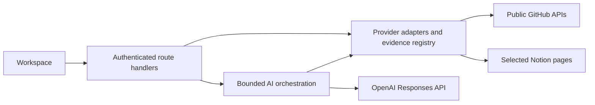

# Architecture and design

Thread answers two separate questions: “Where should I resume my work?” and “Does the work agree with the plan?” PR brief uses personal GitHub activity; Plan check uses an explicitly selected repository and Notion pages. GitHub supplies identity, while Notion is an optional secondary connection.

## Structure

A single Next.js App Router application keeps presentation, provider access and AI orchestration together without a separate backend or database.

| Area                                                       | Responsibility                                                   |
| ---------------------------------------------------------- | ---------------------------------------------------------------- |
| `src/components/dashboard/`                                | Navigation, PR brief and shared inspector                        |
| `src/components/investigator/`                             | Source setup, findings, impact and request lifecycle             |
| `src/app/api/`                                             | Thin authenticated route handlers                                |
| `src/lib/server/github.ts`, `github-brief.ts`, `notion.ts` | Provider retrieval, visibility checks and normalization          |
| `src/lib/server/project.ts`                                | Evidence registry, validated reads and content fingerprints      |
| `src/lib/server/brief.ts`, `investigator.ts`               | Model calls and output validation                                |
| `src/lib/server/*oauth*`, `session.ts`, `api.ts`           | Authentication, encrypted sessions and shared request boundaries |

Shared contracts are in [contracts.ts](../src/lib/contracts.ts); Plan check request, text and model budgets are in [limits.ts](../src/lib/limits.ts). Personal PR collection limits are in [source-selection.ts](../src/lib/source-selection.ts).

## AI flow

**PR brief** retrieves fresh public authored PRs and assigned issues, then makes one structured model call for an overview, observations and a suggested next step.

**Plan check** retrieves the selected sources, then permits up to two evidence-selection calls and one synthesis within a 55-second deadline. The model can request discussion, changed files from a known PR, or an explicitly linked item in the same repository. The server validates and executes these reads; it never fetches a model-supplied URL.

Each source has stable passage IDs, a validated original link and coverage information. File excerpts retain a commit SHA; retrieval checks that the PR head did not move. Zod validates output shape and references against the inspected passages. The model may return zero findings. Prompts distinguish accepted decisions from proposals, account for resolved discussions and equivalent wording, and treat source text as untrusted data.

**Impact assessment** re-fetches sources and replays earlier reads. An HMAC-signed, session-bound receipt contains scope, read descriptors, expiry and a content fingerprint, without source text or credentials. If evidence changes or cannot be reconstructed, another investigation is required.

## Security and failure handling

- GitHub OAuth uses state and PKCE. Notion uses its public OAuth flow; its separate encrypted cookie is bound to the GitHub session and cannot outlive it. Sign-out or a new GitHub login clears the secondary connection.
- Provider tokens never enter browser props or model input. GitHub repository visibility and provider links are validated server-side. Source access is read-only.
- Authenticated same-origin POSTs, bounded bodies and responses, request deadlines and no-store headers apply to data operations. SDK retries and logging are disabled. OpenAI calls use `store: false`, which is not a guarantee of zero provider retention.
- Partial failures preserve inspectable evidence. Model failures do not fabricate output. Expired connections prompt reconnection; provider retry delays disable further requests until retry is allowed.

The browser retains each visited tool while switching views. One request controller owns a Plan check operation, preventing duplicate submissions and obsolete responses from restoring invalidated state. Scope edits, refresh, disconnection and unmount cancel pending work. The details inspector preserves source context without navigating away.

## Trade-offs

Stateless sessions and page-memory results keep deployment simple, at the cost of repeated provider reads and no durable history. Request, pagination, text and model budgets bound latency and cost, but can omit later discussion resolution or relevant implementation. Coverage gaps remain visible with the evidence.

Schema and reference validation cannot establish semantic correctness. Findings must remain qualified, particularly when authority conflicts or coverage is incomplete. Reading a test is not evidence that it passes, and merged work is not proof of deployment.

See [evaluation](evaluation.md) for the recorded checks and their limits, and the [README](../README.md#limitations-and-next-steps) for deployment requirements and next steps.
