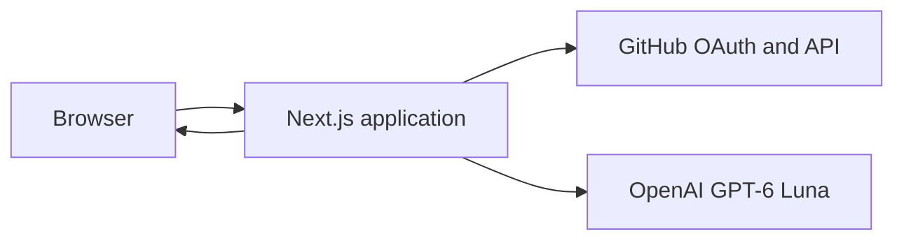

# MySubscriptions product and system design

## Product direction

MySubscriptions helps developers pick up where they left off. It connects to GitHub, presents recent work and open threads, and generates a short AI brief explaining the main themes and a sensible next step.

The value is reconstructing context across related work. Every insight links to its sources so the user can inspect the evidence and act in GitHub. Activity counts are not treated as productivity measures.

This document defines the initial product and system. The [take-home assignment](../MySubscriptions_TakeHome.md) defines the submission requirements.

## Requirements and scope

- Sign in and connect GitHub through one OAuth flow.
- Retrieve and display the user's public PRs and assigned issues.
- Generate a useful brief grounded in the retrieved data.
- Let the user inspect sources, refresh data, copy the brief, and sign out.
- Provide a clearly labelled sample for reviewers with limited public activity.
- Support responsive layouts, keyboard navigation, and recoverable failure states.
- Deliver a public repository, hosted application, setup instructions, `.env.example`, and documentation of limitations and future work.

The first version supports one service and public, read-only data. Private repositories, code analysis, chat, automated GitHub changes, saved history, and background sync are outside scope.

## Technology stack

| Area | Technology |
| --- | --- |
| Application | Next.js App Router, React, TypeScript |
| Interface | shadcn/ui, Tailwind CSS, Lucide icons |
| Authentication | Direct GitHub OAuth; `iron-session` for encrypted cookie sessions |
| GitHub integration | Server-side native `fetch` |
| AI | OpenAI Responses API and official JavaScript SDK |
| Model | GPT-6 Luna, configured as `OPENAI_MODEL=gpt-6-luna` |
| Validation | Zod |
| Testing | Vitest and Playwright |
| Hosting | Vercel, Node.js runtime |
| Tooling | pnpm, committed lockfile, ESLint, TypeScript checks |
| Persistence | No application database |

GitHub is the identity provider. The application owns the small OAuth callback and session flow, without an external auth platform. GitHub's [authorization code flow](https://docs.github.com/en/apps/oauth-apps/building-oauth-apps/authorizing-oauth-apps) supplies identity and API access; [iron-session](https://github.com/vvo/iron-session) handles session encryption. [GPT-6 Luna](https://developers.openai.com/api/docs/models/gpt-6-luna) supports the structured output required by the brief.

## System architecture

One Next.js application contains the interface and server operations. Authentication, GitHub retrieval, and brief generation are separate modules within that application.

Routes and page composition live in `src/app`. Shared shadcn primitives live in `src/components/ui`, and product components such as the brief and source list live in `src/components/dashboard`. Server-only authentication, GitHub, and AI logic live in `src/lib/server`; shared data contracts live in `src/lib/contracts.ts`. UI components receive typed data and callbacks rather than calling providers directly.

The browser displays data and manages interactions. The server authenticates requests, retrieves GitHub data, calls the model, and validates the result. Provider tokens are never exposed to browser JavaScript. There is no separate backend service or application database.

### Authentication

“Continue with GitHub” starts the authorization code flow with state validation and PKCE. The callback exchanges the code server-side, verifies identity through GitHub's user endpoint, and creates a short-lived encrypted, HTTP-only session cookie containing the identity and provider token.

Only public-data permissions are requested. Protected operations derive identity from the session. Expired or revoked access prompts reconnection. Sign-out clears the session and visible data; GitHub authorization can be revoked separately. Stateless sessions do not provide immediate revocation of a copied cookie before expiry.

### Data and generation flow

1. After sign-in, the server fetches and normalizes the selected GitHub data.
2. The dashboard shows the source items, coverage, and fetch time.
3. The user selects “Generate my brief” after seeing what data will be sent to OpenAI.
4. The server fetches a fresh snapshot, makes one structured model request, and validates the response.
5. The dashboard displays the brief alongside the exact snapshot it describes.

Refresh clears the previous brief. A generation failure leaves the source data usable. Briefs and source snapshots are not persisted across sessions.

## Data and AI behaviour

| Data | Selection |
| --- | --- |
| Recently updated authored PRs | Last 14 days, maximum 20 |
| Open authored PRs | Maximum 10, including items outside the recent window |
| Open assigned issues | Maximum 10 |

Each collection is ordered by latest update. Overlapping items are deduplicated. The interface identifies public-only coverage, capped results, and partial retrieval. These selections are not a complete backlog.

The model receives titles, bounded descriptions, repositories, labels, observed statuses, and timestamps. Code, diffs, and full discussion histories are excluded.

The brief contains:

- A short overview of the work.
- Up to three observations connecting related items or surfacing open threads.
- One suggested starting point with a reason, when evidence supports it.
- Source references for substantive claims.

Application code supplies facts and coverage; the model interprets the available text. Zod validates the output, and the server checks source references against the snapshot. Links come from GitHub data rather than model-generated URLs.

The model can return insufficient context instead of inventing a priority. It cannot infer approvals, blockers, code correctness, or completion without evidence. Repository text is treated as untrusted input, and generation has no tools or write access.

## User experience

### Entry

The entry screen leads with “Pick up where you left off,” a representative brief, and two actions: “Continue with GitHub” and “Explore sample.” Public-only access is explained before connection.

### Dashboard

The page follows a single reading order:

1. Connected account, data coverage, fetch time, and refresh action.
2. The work brief and suggested next step.
3. The supporting PRs and issues, with repository, status, update time, and GitHub links.

Before generation, the brief area explains the action while the source list is already usable. Selecting an insight reveals its supporting items. “Copy brief” includes source links.

The sample reuses the dashboard with fixed data and a prerecorded brief. It is visibly labelled and never replaces live results silently.

### Visual design

The visual reference is [Design Systems Surf](https://designsystems.surf/), including its library, footer, and the supplied wave panel. The selected layout leads with the insight. A spacious blue, lavender, peach, and yellow wave panel holds the brief; the next step, controls, and source list sit on white below. Match the reference's Inter Display headings, Inter body text, IBM Plex Mono labels, black pill buttons with white labels, and generous spacing. Colour stays within the brief panel. The measured values and application mapping are recorded in [the visual foundation](design/visual-foundation.md). shadcn/ui supplies shared controls styled through common theme tokens. Desktop and mobile preserve the same content hierarchy; a permanent sidebar is unnecessary. Visual checks cover spacing, typography, contrast, and responsive wrapping.

Delight comes from immediate context, clear evidence, useful copy, and fast navigation back to GitHub. Controls support keyboard use, visible focus, accessible status messages, and reduced motion. Colour is never the only status indicator.

### Failure states

| Situation | Behaviour |
| --- | --- |
| Sign-in cancelled or access expired | Offer retry or reconnect. |
| No matching public activity | Explain the coverage and offer the sample. |
| GitHub data partly unavailable | Show available items and clearly label partial coverage. |
| GitHub data entirely unavailable | Show a retrieval error; do not generate a brief. |
| AI failure or rate limit | Preserve source data and offer an appropriate retry. |
| Weak evidence | State the limitation instead of fabricating an insight. |

## Quality and operational boundaries

Authentication and same-origin checks protect server operations. Cookies use secure production settings. Secrets and source content stay out of logs, and user responses are not placed in shared caches.

Generation has bounded input, output, and request duration, with hosting-level rate limiting. There is no anonymous live generation. Selected public data is sent to OpenAI only on request, with response storage disabled; this does not imply zero provider retention.

Focused tests cover the OAuth callback and session boundaries, data normalization, partial results, source validation, and the main dashboard flow. Live OAuth and model integration are verified on the hosted application. AI evaluation uses related, unrelated, sparse, and adversarial sample descriptions to assess grounding and usefulness.

The database-free design keeps deployment small. It deliberately excludes durable quotas, saved briefs, and cross-device history.

## Future direction

- Add selected comments and review state to improve grounding; refine accessibility and evaluations.
- Add selected private repositories through a GitHub App with granular permissions.
- Validate repeat usefulness, then add saved comparisons or scheduled briefs where justified.
